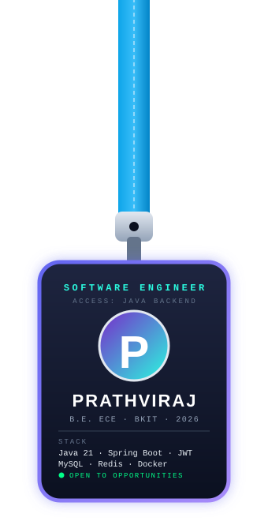

<div align="center">


[](https://github.com/prathvisita)

</div>

---

<table>
<tr>
<td width="340" align="center" valign="middle">

<a href="https://github.com/prathvisita"></a>

</td>
<td valign="middle">

###   Turning Ideas into Working Software

-   B.E. Electronics & Communication · Bheemanna Khandre Institute of Technology · Graduating **2026**
-   Focused on **Java 21, Spring Boot, REST APIs & Microservices**
-   Building with **Spring Security, JWT, Hibernate/JPA & Redis**
-   Comfortable across **MySQL, MongoDB & Redis**
-   Exploring **AI: LLMs & RAG** alongside core software engineering
-   Android App Developer Intern @ **Mindmatrix**
-   Always shipping, always learning

>   *"Build it, ship it, learn from it."*

</td>
</tr>
</table>

---

[](https://github.com/prathvisita)

<div align="center">

[](https://github.com/prathvisita)

</div>

<div align="center">


</div>

---

<table>
<tr>
<td width="400" align="center" valign="middle">

<a href="https://github.com/prathvisita"></a>

</td>
<td valign="middle">

###   About Me

-   I'm an **aspiring backend engineer** building production-style systems
-   Deeply interested in **Backend Engineering, System Design & AI**
-   I care about **secure APIs, clean architecture and well-tested code**
-   Currently learning **advanced system design, microservices patterns & RAG-based AI apps**
-   I don't just learn technologies, **I build with them**
-   Fun fact: I turn simple ideas into real, working systems
-   Open to **Java Backend Developer / Software Engineer** roles (fresher)
-   Constantly exploring new technologies through **hands-on projects & experimentation**

</td>
</tr>
</table>

<div align="center">


</div>

---

##   Connect With Me

[](https://www.linkedin.com/in/prathviraj-sita-0260aa381/)
[](https://github.com/prathvisita)
[](mailto:prathvisita67@gmail.com)
[](https://prathvisita.github.io)

---

##   Experience

###   Android App Developer Intern — Mindmatrix, Bengaluru

  February 2026 – May 2026

-   Integrated **REST APIs using Retrofit** to sync data between the mobile app and backend services, handling JSON mapping and error cases
-   Built features in **Kotlin using MVVM** with ViewModel, LiveData and RecyclerView for better modularity and maintainability
-   Implemented offline persistence with **Room database** for faster load times
-   Wrote **JUnit unit tests** to improve stability before release
-   Worked with Git-based workflows, code reviews and Agile sprints in an existing codebase


---

##   Technical Skills

###   Languages


###   Backend


###   Databases


###   DevOps & Cloud


###   Testing & API Tools


###   Frontend


###   Mobile


###   Tools & Platforms


---

##   Featured Projects

###   E-Commerce Backend

Modular REST backend with **5 services** (users, catalog, cart, orders, payments) on a normalized, indexed MySQL schema.

-   Secured with **Spring Security + JWT** (access/refresh tokens) and role-based access for customers and admins
-   Payment gateway sandbox integration with **webhook handling and idempotent order/payment processing** to prevent duplicate charges
-   **Redis caching** for catalog and product lookups, plus pagination, filtering and search endpoints
-   JUnit + Mockito tests, **Swagger/OpenAPI** docs, Dockerized, with a **GitHub Actions CI/CD** pipeline


[](https://github.com/prathvisita/E-Commerce-Backend)

###   Food Delivery Backend

REST backend for restaurants, menus, orders, delivery assignment and live order tracking across **3 roles**: customer, restaurant and delivery partner.

-   Order lifecycle modeled as a **state machine** (placed → accepted → preparing → out for delivery → delivered / cancelled) with validated transitions and status history
-   **Event-driven notifications** using Spring application events to decouple order updates from notification logic
-   JWT authentication, role-based authorization, input validation and centralized exception handling
-   Redis caching for menus, structured logging, JUnit/Mockito coverage and **Docker Compose** for one-command local setup


[](https://github.com/prathvisita/Food-Delivery-Backend)

###   Student Management System

Spring Boot backend for managing student records through REST APIs.


[](https://github.com/prathvisita/Student-Management-System)

<!-- If your repo names are different, change the three links above to match exactly -->

---

##   Profile Views

[](https://github.com/prathvisita)
[](https://github.com/prathvisita?tab=followers)

---

##   GitHub Stats

[](https://github.com/prathvisita)
[](https://github.com/prathvisita)

---

##   GitHub Streak

[](https://git.io/streak-stats)

---

##   GitHub Highlights

[](https://github.com/prathvisita?tab=repositories)
[](https://github.com/prathvisita?tab=followers)
[](https://github.com/prathvisita?tab=following)

---

##   Contribution Snake


---

##   Certifications

| Certification | Issuer |
|:--|:--|
|  Test Driven Development in Java for Beginners | **Coursera** |
|  Introduction to Artificial Intelligence | **Coursera** |
|  Infosys Accessibility Testing Tool | **Infosys Springboard** |

---

##   Education

| Qualification | Institution | Year | Score |
|:--|:--|:--|:--|
| B.E. Electronics & Communication | Bheemanna Khandre Institute of Technology | 2022 – 2026 | CGPA 8.0 |
| PUC (XII) | Daimond Independent PU College | 2018 – 2020 | 85% |
| SSLC (X) | CB Gurukul Kardyal | 2018 | 87% |

---

##   Core Computer Science

```
╔══════════════════════════════════════╗  ╔════════════════════════════════════╗
║  Data Structures & Algorithms        ║  ║  Object-Oriented Programming       ║
╠══════════════════════════════════════╣  ╠════════════════════════════════════╣
║  System Design & Design Patterns     ║  ║  Multithreading & Concurrency      ║
╠══════════════════════════════════════╣  ╠════════════════════════════════════╣
║  Relational Data Modeling            ║  ║  Query Optimization & Indexing     ║
╚══════════════════════════════════════╝  ╚════════════════════════════════════╝
```

---

###   Dev Quote of the Day

[](https://github.com/prathvisita)

---

##   Contact

[](https://www.linkedin.com/in/prathviraj-sita-0260aa381/)
[](https://github.com/prathvisita)
[](mailto:prathvisita67@gmail.com)

[](https://github.com/prathvisita)


